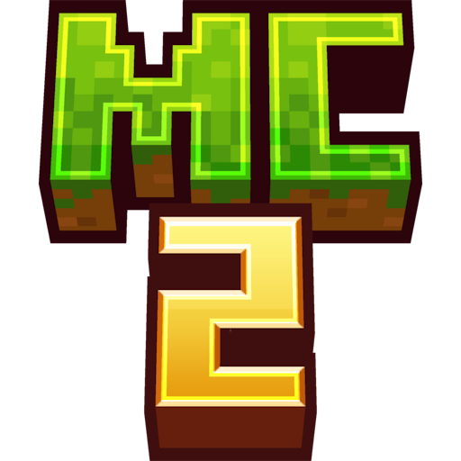

  

  # Minecraft 2 Mod

  **Reimagine Minecraft. Redefine the experience.**

  A vanilla+ overhaul focused on deeper progression, meaningful crafting, better achievements, and more rewarding exploration.

  
  
  
  

---

## About

**Minecraft 2 Mod** is an ambitious vanilla+ overhaul that aims to improve and rethink Minecraft's core gameplay without losing the freedom, creativity, and identity that make the game special.

Instead of simply adding more items and mobs, the project focuses on making existing systems work together. Crafting should feel purposeful, progression should reward curiosity and effort, and exploration should open up new possibilities.

> The goal is not to make Minecraft unrecognizable. It is to make its systems more meaningful, connected, and rewarding.

## Design Goals

- **Meaningful progression** — make each stage of survival feel useful and rewarding.
- **Deeper crafting** — give materials, tools, and crafting stations clearer purposes.
- **Better achievements** — turn achievements into a more useful guide to discovery and mastery.
- **Rewarding exploration** — make structures, discoveries, and rare resources matter to progression.
- **Improved existing systems** — revisit underused mechanics such as farming, enchanting, villagers, archaeology, and redstone.
- **Vanilla+ identity** — expand the game while preserving its recognizable style and freedom.
- **Cohesive design** — make new and reworked features support one another instead of feeling disconnected.

## Planned Features

The following are **project goals**, not a claim that every feature is already implemented.

### Progression

A more deliberate journey from the first tools to endgame content, with fewer stages that become obsolete immediately and more reasons to explore, prepare, and specialize.

### Crafting and Materials

A crafting system with more meaningful recipes and, where appropriate, multi-step fabrication for advanced equipment and technology. Everyday essentials should remain convenient to craft.

### Achievements and Objectives

A more useful progression journal built around discovery, mastery, and optional challenges. Rewards should unlock knowledge or possibilities rather than simply hand out powerful items.

### Exploration and Endgame

More reasons to investigate structures, biomes, and dimensions, with discoveries that can influence crafting and progression. Defeating the Ender Dragon should feel like a milestone—not necessarily the end of the journey.

### Underused Mechanics

Potential improvements to farming, animal husbandry, villagers, enchanting, potions, archaeology, fishing, and redstone, with each system given a clearer role in the wider game.

## Technical Direction

| Component | Target |
| --- | --- |
| Minecraft | Java Edition 1.21.1 |
| Mod loader | Fabric |
| Language | Java 21 |
| Build system | Gradle |
| Architecture | Modular core with separate gameplay systems |
| Configuration | Data-driven definitions where practical |

The intended architecture separates shared progression rules from individual systems such as crafting, equipment, achievements, exploration, and the endgame. This should make the project easier to test, maintain, and expand.

## Project Status

**Minecraft 2 Mod is in development.** Features and design decisions may change as the overhaul takes shape. Compatibility, balance, and multiplayer behavior will need to be tested as systems are implemented.

## Contributing

Contributions, ideas, and constructive feedback are welcome once the project structure and contribution guidelines are established.

Before contributing, please check the repository's open issues and existing discussions to avoid duplicating work. For substantial changes, open an issue first to discuss the proposed design.

## License

Minecraft 2 Mod uses separate terms for source code and original assets:

- **Source code:** MIT License. You may use, modify, and redistribute the code under the conditions of the MIT License.
- **Original assets:** All Rights Reserved (ARR), unless a specific asset states otherwise. This covers original artwork, textures, models, animations, sounds, and other creative resources. Permission is required for reuse or redistribution where applicable.
- **Third-party materials:** remain under their respective licenses.

See the `LICENSE` file for the full terms. The code license does not grant permission to reuse assets marked All Rights Reserved.

## Disclaimer

Minecraft 2 Mod is an independent community project and is not affiliated with, endorsed by, or officially associated with Mojang Studios or Microsoft. Minecraft and its related trademarks belong to their respective owners.

---

  Built around one idea: keep the soul of Minecraft, make every system matter.

